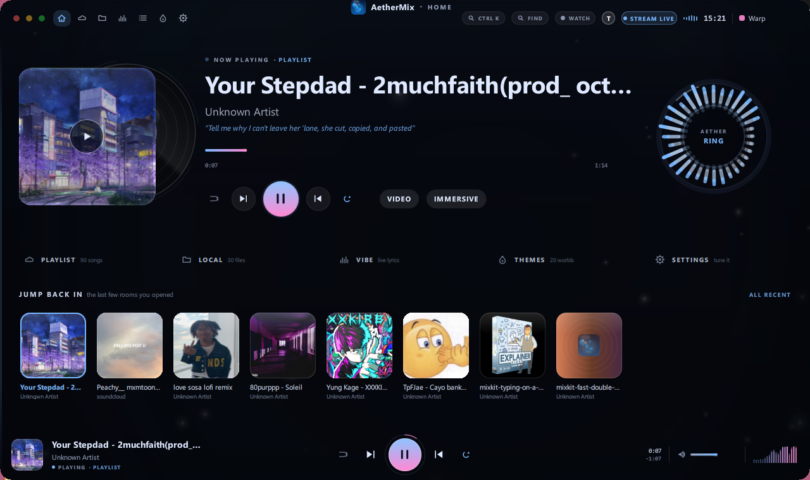
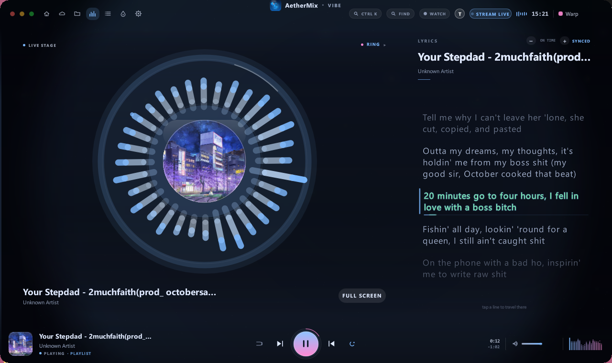
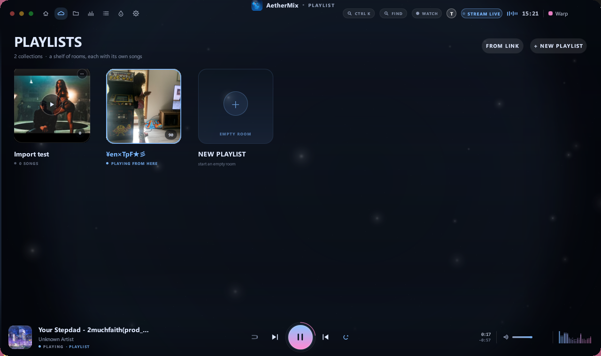
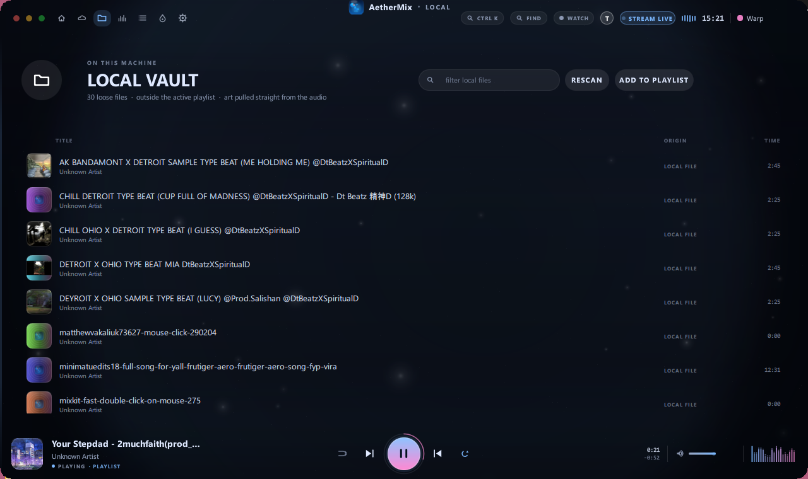
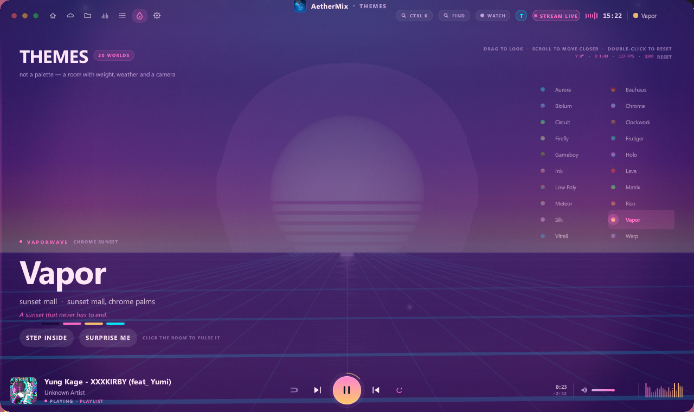
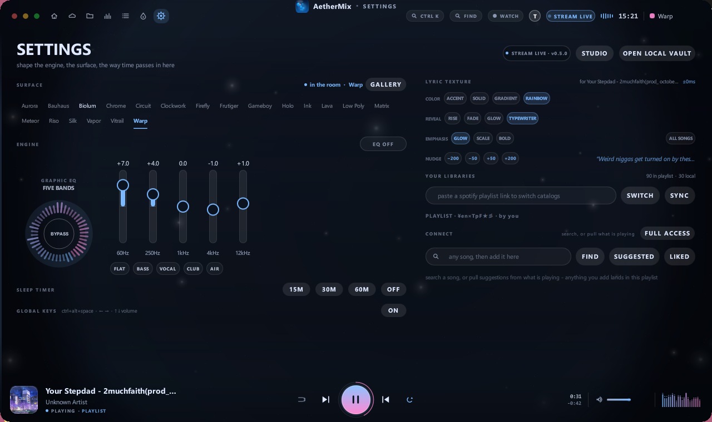

# AetherMix

A music player for Windows that treats the library as a place, not a list.
Native Rust + Qt/QML — no Electron, no embedded browser shell, no account
required to press play.



One library, three ways in: files on your disk, songs streamed from YouTube or
SoundCloud, and the shelf of rooms (playlists) you arrange on top. The whole
look is a themed 3D room — twenty of them ship in the box — and every tab can
wear a different one.

**Showcase (30 s):** [docs/media/aethermix-showcase.mp4](docs/media/aethermix-showcase.mp4)

---

## What is in it

**Playback**
- Local files (mp3, flac, ogg, opus, wav, m4a, aac) read from `~/Music`,
  `~/Music/AetherMix`, `~/Downloads`, or `AETHER_MUSIC`.
- Streaming rows: a YouTube or SoundCloud page stays a page and is decoded into
  the audio ring through `yt-dlp` + `ffmpeg`; pause, seek and skip work like a
  file, and nothing is written to disk unless you ask.
- One click turns a streamed row into a local `.mp3` (tagged, cover attached).
- Queue, shuffle, repeat, sleep timer with a real volume fade, a resume-where-
  you-left chip, global hotkeys, likes and play counts.

**Rooms (playlists)**
- A shelf of playlists, each with its own cover, name, owner and songs.
- Create from scratch, from a YouTube / SoundCloud / Spotify playlist link, or
  from an `.m3u8`. Rename, re-face or retire a room from its own hover menu;
  retiring moves the file into `library/backups/` instead of deleting it.
- Songs can be removed, liked, sorted, filtered and searched. The room count and
  the local vault are counted apart, so "how many songs do I have" always has
  one honest answer.

**The room itself**
- 20 themes, each a designed 3D world (archetype, palette, camera, particles,
  weather) rather than a colour swap: Vaporwave Chrome Sunset, Bioluminescent
  Deep, Bauhaus Stage, Clockwork Atelier, Vitrail, Riso, Matrix, Lava and more.
- Per-tab themes: point Playlist at Ink, Vibe at Aurora, keep Home on Warp.
- Type control (family, size, colour), opacity / blur / tint over any wallpaper,
  video or GIF, animated background — all in Studio.

**Words and pictures**
- Synced lyrics from `lrclib`, with a per-song nudge that is saved per song, and
  embedded `.lrc` or tag lyrics first. The matcher strips uploader prefixes,
  `feat.` / `feat_` credits and bracketed noise, so a messy YouTube download
  still finds its words.
- Vibe page: the ring visualiser and the words line by line on the audio clock.
- Watch: a video pane that plays the song's video in YouTube's own player, with
  no page chrome and no ads around it.
- Immersive mode: the cover (or the video) as the room, lyrics in front.

**Two harnesses, one inventory**
- **The phone page** — open `http://<pc-ip>:3690/m` in Safari, add it to the
  home screen, and the tile wears the app's icon. It is a full second client:
  its own queue and clock, visualiser, synced lyrics, rooms, search, the theme
  set, a playlist converter, a YouTube watch tab — and it keeps playing with the
  screen off, with lock-screen skip and ±10 s. Add a song from a search result
  as a **stream** (relayed through the PC, nothing written) or a **download**
  (the row appears at once and becomes a local file when it lands), and give a
  room a face from its own art.
- **The iPhone client** — `ios/` is a native SwiftUI app (iOS 16+) that streams
  the same library over the LAN, with the desktop's themes and lock-screen
  controls, plus a GitHub Actions workflow that builds an unsigned IPA for
  Sideloadly without a Mac. See [docs/IOS_PORT.md](docs/IOS_PORT.md).

The laptop and the phone are separate players over one library: the phone never
drives the desktop's deck, and either can play something different.

## Screenshots

| | |
|---|---|
|  |  |
| Home: last played, the deck, recent rooms | Vibe: ring visualiser and synced words |
|  |  |
| The shelf of rooms | Local vault, counted apart from playlist songs |
|  |  |
| Themes: a room per world | Settings and the equaliser |

## Build

Windows 10/11, Rust stable, Qt 6.5+ (tested with 6.12.0 mingw), and a mingw
toolchain for the `x86_64-pc-windows-gnu` target.

```bash
# 1. qmake is how the QML bindings find Qt
export QMAKE="C:/Qt/6.12.0/mingw_64/bin/qmake.exe"

# 2. build
cargo build --release --target x86_64-pc-windows-gnu

# 3. copy the Qt runtime next to the exe (once)
/c/Qt/6.12.0/mingw_64/bin/windeployqt.exe --no-translations \
  target/x86_64-pc-windows-gnu/release/aethermix.exe

# 4. run
target/x86_64-pc-windows-gnu/release/aethermix.exe
```

`build.rs` bakes the checkout path in as `AETHER_ROOT` and the QML resolves its
own assets relatively, so a clone anywhere on disk works — nothing is pinned to
one folder.

**Extractors.** Streaming and downloads lean on two binaries that are not
vendored here. Drop them in `bin/`:

- `bin/yt-dlp.exe` — <https://github.com/yt-dlp/yt-dlp/releases>
- `bin/ffmpeg.exe` — <https://www.gyan.dev/ffmpeg/builds/> (essentials build)

Without them the app still plays local files; search, stream and download report
the missing extractor instead of failing silently.

**Music folders.** `~/Music`, `~/Music/AetherMix` and `~/Downloads` are scanned
on start. Point it somewhere else with `AETHER_MUSIC`:

```powershell
$env:AETHER_MUSIC = "D:/Audio;E:/Rips"
```

**Spotify (optional).** Local files, YouTube/SoundCloud and the whole UI work
without an account. Linking one in Studio → Accounts adds catalog search and
Spotify playlist import ([docs/IOS_PORT.md](docs/IOS_PORT.md) covers what is and
is not possible there).

## Phone

1. Launch the app. The top bar shows `STREAM LIVE` while the LAN gateway is
   open, and Studio prints the exact address.
2. On the phone, open `http://<pc-ip>:3690/m` in Safari → Share → Add to Home
   Screen.
3. Switch the gateway off in Studio when the port should not be reachable; the
   choice persists across launches.

Non-loopback callers may reach everything except an explicit list of
loopback-only routes: the gateway switch itself, accounts and OAuth, shell and
window control, appearance writes, and any route that takes a filesystem path
from the caller. The list is `LOCAL_ONLY` in [src/server.rs](src/server.rs).

## Keyboard

| | |
|---|---|
| `Ctrl+K` | command palette |
| `Ctrl+B` | browse / open a link |
| `Ctrl+F` | find across YouTube, SoundCloud, Spotify |
| `Ctrl+,` | studio |
| `Ctrl+Alt+Space` | play / pause (system-wide) |
| `Ctrl+Alt+Left / Right` | previous / next |
| `Ctrl+Alt+Up / Down` | volume |
| `F11` | full screen |
| `Esc` | close whatever is open |

## Where the rest is written down

- [docs/FEATURES.md](docs/FEATURES.md) — likes, sort/filter, resume, sleep v2,
  m3u export/import, track info, global keys, and how each was verified.
- [docs/UI_AND_MOTION.md](docs/UI_AND_MOTION.md) — layout grammar, transition
  timings, theme schema, background archetypes, and the traps in this codebase.
- [docs/PERFORMANCE.md](docs/PERFORMANCE.md) — measured CPU/RAM and the knobs.
- [docs/IOS_PORT.md](docs/IOS_PORT.md) — the phone page, the native client, the
  Sideloadly path, and the things iOS does not allow a web page to do.
- [docs/AUDIT.md](docs/AUDIT.md) — probing the bridge for bugs.

## Status, honestly

- Windows only. The UI is Qt/QML over a small localhost bridge; the Rust core is
  portable, the window chrome and the mingw build are not.
- A web page added to the iOS home screen cannot ship a widget: widgets are a
  WidgetKit extension inside a signed app. The phone page therefore gives a real
  lock-screen Now Playing card (cover, transport, ±10 s) and a proper home-screen
  icon, and the native client in `ios/` is the route to real widgets.
- Streaming depends on `yt-dlp` staying ahead of the sites it reads. When a site
  changes, update that binary; the app reports the extractor's own error.
- Your music, artwork and sessions live in `library/`, `cache/` and
  `accounts.json`, and are git-ignored on purpose.

## License

MIT — see [LICENSE](LICENSE).
